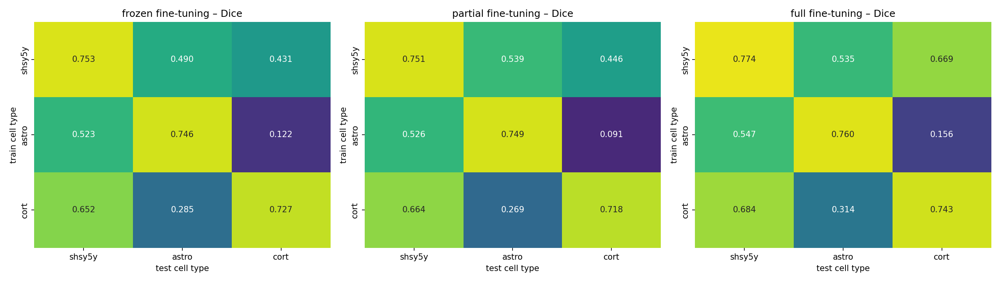
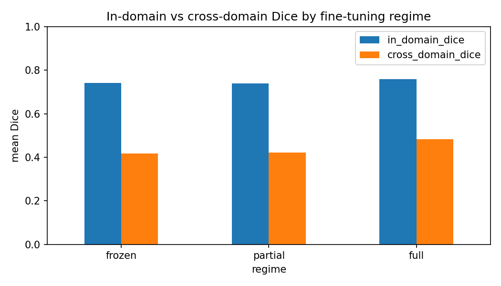

# Cell Segmentation under Domain Shift: Does Fine-Tuning Depth Matter?

Empirical study of how a U-Net cell segmentation model transfers across cell types (Sartorius phase-contrast dataset), comparing frozen, partial and full fine-tuning of an ImageNet-pretrained encoder, with error analysis and a label-free test-time adaptation baseline. Trained on Kaggle GPU.

> ⚠️ Research project only — single seed, semantic (foreground) masks.

**Key results**

- **In-domain:** all regimes reach Dice **~0.74–0.76** on the cell type they were trained on (full fine-tuning best: **0.759**).
- **Cross-domain:** Dice falls to **0.417** (frozen) / **0.423** (partial) / **0.484** (full) when the cell type changes.
- **Full fine-tuning shrinks the gap:** in→cross drop **0.325 → 0.274**, the opposite of "more adaptation = more overfitting".
- **Partial ≈ frozen:** unfreezing only the last encoder stage gave no benefit (0.739 vs 0.742 in-domain).
- **Astrocytes are the outlier domain:** astro → cort is the hardest transfer in every regime (**0.09–0.16** Dice).
- **Test-time BatchNorm adaptation hurt every regime** (−0.040 / −0.054 / **−0.133**), most for the most fine-tuned model.
- Notebook: [Kaggle notebook](https://www.kaggle.com/code/wajidali99/cell-segmentation-under-domain-shift)

## Status

- [x] Step 0 — Project setup (Kaggle, GPU, Sartorius data)
- [x] Step 1 — Data audit: RLE decoding, per-cell-type 80/20 split by image
- [x] Step 2 — Domain statistics (intensity, contrast, foreground density)
- [x] Step 3 — U-Net (ResNet-34) with three fine-tuning regimes
- [x] Step 4 — 3 regimes × 3 source cell types = 9 training runs (20 epochs each)
- [x] Step 5 — 3×3 cross-cell-type transfer matrices (Dice, IoU)
- [x] Step 6 — In-domain vs cross-domain summary
- [x] Step 7 — Qualitative error maps (TP / FP / FN)
- [x] Step 8 — Label-free test-time BatchNorm adaptation
- [ ] Step 9 — Repeat with 3 seeds for error bars
- [ ] Step 10 — True PEFT arm (LoRA on a foundation encoder, e.g. SAM / ViT)

## Research question

A segmentation model trained on one kind of cell image often fails on another — a new cell line, microscope or experimental batch. Does **how much of a pretrained encoder we fine-tune** change this?

## Dataset

[Sartorius – Cell Instance Segmentation](https://www.kaggle.com/competitions/sartorius-cell-instance-segmentation) (Kaggle). Phase-contrast microscopy of neuronal cells, 520×704 px. Instance RLE annotations were merged into one binary foreground mask per image.

| Cell type | Images | Train | Test | Mean contrast (std) | Foreground fraction |
|---|---|---|---|---|---|
| shsy5y | 155 | 124 | 31 | 12.1 | **20.2%** |
| astro | 131 | 105 | 26 | 7.9 | **19.4%** |
| cort | 320 | 256 | 64 | 13.7 | **2.2%** |

Mean brightness is almost identical across cell types (~128). The domains differ mainly in **foreground density** (2% vs ~20%) and **morphology**: small dense cells (shsy5y), long branching processes (astro), sparse small round cells (cort).

## Method

| | |
|---|---|
| Model | U-Net, ResNet-34 encoder (ImageNet-pretrained), `segmentation_models_pytorch` |
| Input | Grayscale → 512×704, per-image z-score normalisation, replicated to 3 channels |
| Loss | BCE + Dice |
| Optimiser | AdamW, lr 3e-4, cosine schedule, 20 epochs, batch 8, mixed precision |
| Augmentation | Flips, brightness/contrast, Gaussian noise |
| Protocol | Train on one cell type → test on the held-out images of all three |

**Fine-tuning regimes**

| Regime | What is trained | Trainable params |
|---|---|---|
| Frozen | Decoder only (encoder + its BatchNorm statistics fixed) | 3.15M (13%) |
| Partial | Decoder + last encoder stage (`layer4`) | 16.27M (67%) |
| Full | Everything | 24.44M (100%) |

## Results

### Transfer matrices (Dice, rows = train cell type, columns = test cell type)



| Train → Test | Frozen | Partial | Full |
|---|---|---|---|
| shsy5y → shsy5y | 0.753 | 0.751 | **0.774** |
| shsy5y → astro | 0.490 | **0.539** | 0.535 |
| shsy5y → cort | 0.431 | 0.446 | **0.669** |
| astro → shsy5y | 0.523 | 0.526 | **0.547** |
| astro → astro | 0.746 | 0.749 | **0.760** |
| astro → cort | 0.122 | 0.091 | **0.156** |
| cort → shsy5y | 0.652 | 0.664 | **0.684** |
| cort → astro | 0.285 | 0.269 | **0.314** |
| cort → cort | 0.727 | 0.718 | **0.743** |

### In-domain vs cross-domain



| Regime | Trainable | In-domain Dice | Cross-domain Dice | Drop |
|---|---|---|---|---|
| Frozen | 3.15M | 0.742 | 0.417 | 0.325 |
| Partial | 16.27M | 0.739 | 0.423 | 0.317 |
| Full | 24.44M | **0.759** | **0.484** | **0.274** |

### Test-time BatchNorm adaptation (unlabeled target images)

| Regime | Cross-domain Dice before | After BN adaptation | Change |
|---|---|---|---|
| Frozen | 0.417 | 0.377 | −0.040 |
| Partial | 0.423 | 0.369 | −0.054 |
| Full | 0.484 | 0.351 | **−0.133** |

## Findings

1. **Full fine-tuning was best both in- and out-of-domain.** Mean in-domain Dice: frozen 0.742, partial 0.739, full 0.759. Mean cross-domain Dice: 0.417 / 0.423 / 0.484. The in→cross drop *shrank* with full fine-tuning (0.325 → 0.274).
2. **Unfreezing only the last encoder stage did not help.** Partial ≈ frozen, suggesting the domain gap sits in early/mid-level features, not only high-level ones.
3. **Largest gain from adaptation: shsy5y → cort** (0.431 frozen → 0.669 full, +0.24).
4. **Astrocytes are the outlier domain.** astro → cort was the hardest transfer in every regime (0.09–0.16 Dice) and cort → astro was also weak (0.27–0.31). Error maps show that on astrocytes the dominant error is missed thin processes (false negatives), while on sparse cort images the frozen model adds false positives that full fine-tuning largely removes.
5. **Naive test-time BatchNorm adaptation hurt every regime.** Re-estimating BN statistics on unlabeled target images lowered mean cross-domain Dice by 0.040 (frozen), 0.054 (partial) and 0.133 (full). The more of the network was fine-tuned, the larger the drop, suggesting fine-tuned layers co-adapt to source BN statistics. Together with the domain statistics above, this suggests the shift is **structural** (foreground density, morphology), not a simple intensity shift.
6. **Training converged by ~15 epochs in all runs**, so differences are not due to under-training.
7. **Link to prior work:** consistent with the finding that frozen encoders with light adaptation are insufficient for cell segmentation (Hwang et al., *Is PEFT Enough for Cell Segmentation?*, ICML 2026 FM4LS workshop).

## Limitations

- Single seed — differences of ±0.01 (e.g. frozen vs partial) are within noise.
- Semantic masks only; instance-level metrics (e.g. AP at IoU thresholds) not evaluated.
- "Partial" is a simple layer-unfreezing baseline, not a true PEFT method (LoRA / adapters).
- One dataset and one imaging modality (phase contrast).

## Next steps

- 3 seeds with error bars.
- LoRA / adapter arm on a foundation encoder (SAM, ViT) to compare true PEFT with full fine-tuning.
- Leave-one-cell-type-out training (train on two types, test on the third).
- Foreground-density-aware loss or sampling to tackle the cort sparsity gap.

## How to run

1. Open `cell_seg_domain_shift.ipynb` on Kaggle.
2. *Add Input* → Competitions → `sartorius-cell-instance-segmentation` (accept the competition rules first).
3. Enable **GPU (T4 / P100)** and **Internet**.
4. Run all — about 20–25 min on a T4 for the 9 training runs.

Outputs: `results.csv`, `tta_bn_results.csv`, `transfer_matrices.png`, `in_vs_cross.png`.

## Repository structure

```
cell-seg-domain-shift/
├── cell_seg_domain_shift.ipynb   # full pipeline: data → training → analysis
├── results.csv                   # 27 rows: regime × source × target, Dice & IoU
├── tta_bn_results.csv            # test-time BN adaptation results
├── transfer_matrices.png
├── in_vs_cross.png
└── README.md
```

## Author

**Wajid Ali Khan** — [GitHub](https://github.com/wajidali99) · [Hugging Face](https://huggingface.co/Wajiddev99) · [Kaggle](https://www.kaggle.com/wajidali99)
